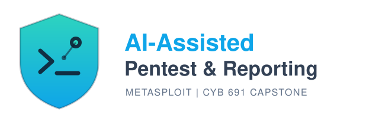

<p align="center">
  
</p>

<h1 align="center">AI-Assisted Automated Penetration Testing and Security Report Generation Using Metasploit</h1>

<p align="center">
  <b>CYB 691 Cybersecurity Capstone</b> &nbsp;|&nbsp; Pace University, Seidenberg School &nbsp;|&nbsp; Fall 2026 &nbsp;|&nbsp; Group 1
</p>

<p align="center">
  
  
  
  
</p>

---

## What this project is

A private, human-supervised lab application that assists selected phases of an authorized
penetration test and then helps draft the security report. The workflow is:

```
Authorized target  ->  Scope check  ->  Nmap discovery  ->  Candidate match
      ->  Human approval  ->  Reviewed Metasploit validation  ->  Evidence store
      ->  Fixed-template report  +  AI-assisted draft  ->  Human review and export
```

The AI component only drafts reporting text from stored evidence. It has no authority to
launch tests, change factual fields, or invent findings. A person approves every test and
reviews every report before export.

The research question we are answering:

> Does a human-supervised, AI-assisted Metasploit workflow reduce assessment and reporting
> effort while maintaining evidence accuracy in a controlled lab?

To answer it we compare three conditions on the same evidence: fully manual, automated with a
fixed template and no AI, and automated with an AI-assisted draft.

## Why it matters

An assessment usually spans separate discovery tools, vulnerability references, validation
steps, scattered evidence files, and a hand-written report. This project tests whether a
bounded integration of those steps saves operator effort without losing traceability or
accuracy, and whether an AI drafting step adds anything measurable on top of plain automation.

## Scope and safety rules

This is lab software for authorized targets only. It is not a tool for scanning systems you do
not own or have written permission to test.

- The backend enforces scope. A checkbox in the interface is never enough.
- Approval binds a specific target, module, and parameters. Changed parameters need re-approval.
- Unapproved tests stay unexecuted and are shown as not tested.
- A timeout or a failed check is not proof that a system is secure.
- The reporting model cannot authorize or run anything.
- No persistence, credential harvesting, evasion, destructive tests, or denial of service.

See [docs/rules-of-engagement.md](docs/rules-of-engagement.md) before any active testing.

## Repository layout

```
Capstone-Project/
├─ README.md                 you are here
├─ capstone/                 working prototype (FastMCP server + package)
│  ├─ server.py              tool server entry point
│  └─ mcp/                   python package and dependencies
└─ docs/                     team materials, start here if you just cloned this
   ├─ onboarding.md          read-me-first guide for new team members
   ├─ architecture.md        components, data flow, and trust boundaries
   ├─ roadmap.md             condensed build plan and milestones
   ├─ roles.md               who owns what
   ├─ references.md          standards, tool docs, and reading list
   ├─ glossary.md            shared vocabulary
   └─ assets/                logo and images
```

Note on the prototype: the code in `capstone/` is an early stub and does not run yet because
its inner package is named `mcp`, which collides with the official `mcp` SDK that the server
depends on. The fix and the full plan are tracked in [docs/roadmap.md](docs/roadmap.md).

## Quick start for team members

1. Read [docs/onboarding.md](docs/onboarding.md). It is a complete brief on the course, the
   project, the rules, and what is expected.
2. Skim [docs/architecture.md](docs/architecture.md) so the component names make sense.
3. Check [docs/roles.md](docs/roles.md) for your area and your backup reviewer.
4. Keep [docs/references.md](docs/references.md) open while you build.

## Team

Group 1, four members:

| Member | Primary area |
| --- | --- |
| Liliya Daroshka | AI reporting, grounding controls, report-quality evaluation |
| Shivam Saluja | Lab setup, Metasploit integration, test-case ground truth |
| Valeriano Bardhi | Interface, approvals and evidence views, export |
| Vijaysingh Mahendrasingh Puwar | Backend, workflow coordination, authorization, integration |

Areas are a starting split and should be confirmed by the team. Everyone contributes to the
literature review, testing, writing, and the presentation.

## Key dates

| Milestone | Date |
| --- | --- |
| Topic chosen | 16 Sep 2026 |
| Progress reports | 29 Oct and 12 Nov 2026 |
| Draft for feedback | 19 Nov 2026 |
| Final report and live demo | 17 Dec 2026 |

The final demo must run live and offline on a laptop in the classroom. Build toward that.

## References

A full annotated list is in [docs/references.md](docs/references.md). The core set:

- NIST SP 800-115, technical guide to information security testing and assessment.
- Metasploit Framework documentation and RPC API, Rapid7.
- Nmap XML output format.
- NVD vulnerability APIs and the CVE program.
- FIRST CVSS v4.0 user guide.
- OWASP guidance on prompt injection and web security testing.
- FastAPI, Streamlit, and pytest documentation.

## License and use

For coursework and authorized lab use only. Do not commit secrets, API keys, course PDFs, or
raw evidence from real systems. Commit only sanitized fixtures and measurements.
